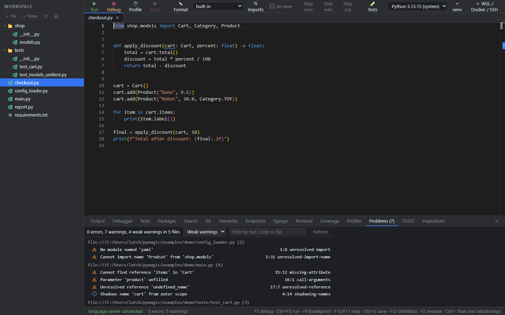
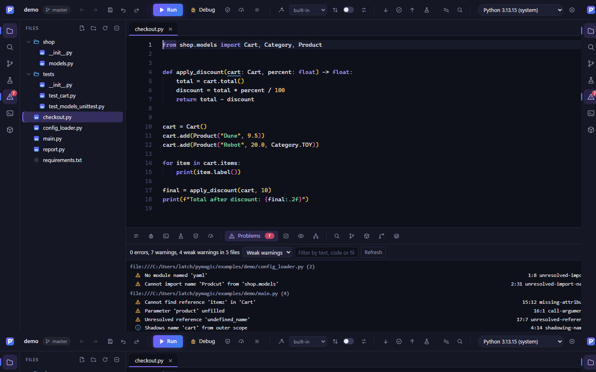
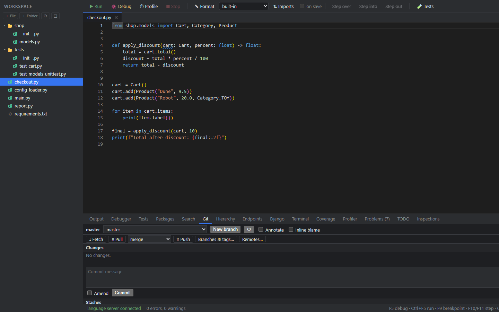
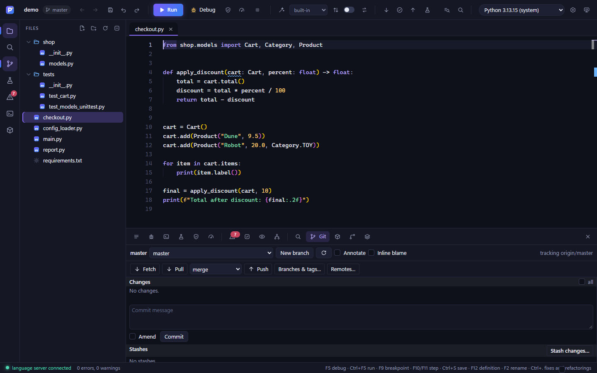
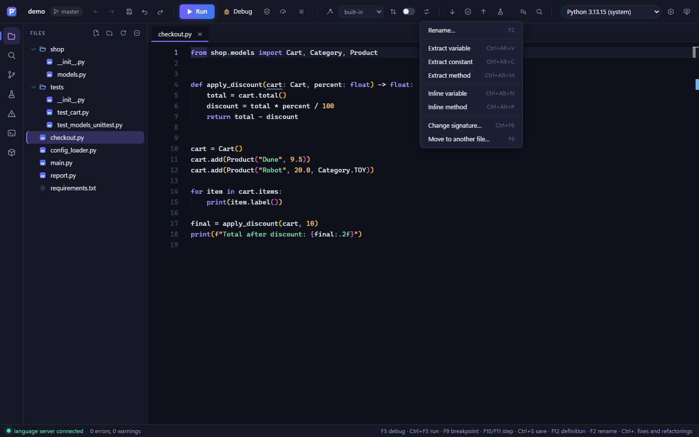
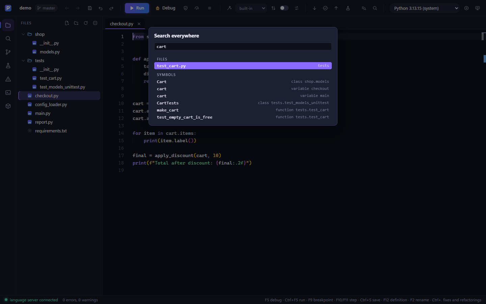
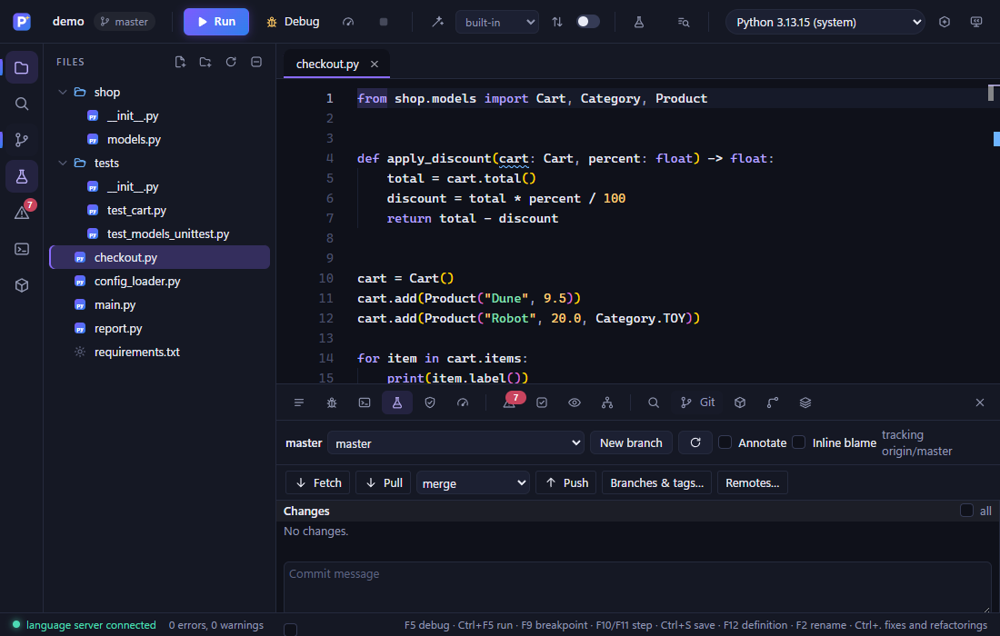

# The look of PyMagic

PyMagic has a look and a layout of its own. It is not a copy of PyCharm, and it uses no icon, name, logo or trademark of JetBrains. This note says what the look is, so that the next screen, dialog or panel is made the same way. (It is the design note asked for in issue #5; the screenshots are the demo project at 1440 x 900.)

| Before | After |
|---|---|
|  |  |
|  |  |

The command bar's menus and picker:  

At 1100 x 700 the dock keeps only the icons of the tools that are shut, and the command bar drops its labels: 

## What was wrong

- The colours, the single bar on top, the tree on the left and the flat row of fifteen text tabs below were the layout of the tool PyMagic is often compared to. Nothing said "PyMagic".
- The toolbar was text buttons with emoji; at 1440 pixels it already wrapped ("Step over", "WSL / Docker / SSH"), and three of its buttons only mattered while debugging.
- Every panel styled its own buttons, boxes and checkboxes, with 57 hard-coded colours in one 640-line HTML file, so no two panels agreed.

## The identity

PyMagic's own icon is a violet-to-blue tile with a golden spark. The look is made from those three colours on deep blue-black surfaces: violet marks what is chosen or active, the spark is the only warm accent, and meanings (good, warning, bad, information) have one colour each everywhere.

Everything is a token in `web/src/look.css`. A new rule uses a token, never a colour.

| Token | Value | Used for |
|---|---|---|
| `--bg` | `#0f111a` | where code and output are read (editor, dock bodies) |
| `--panel` | `#151824` | the frame: command bar, rail, explorer, tab strips, status bar |
| `--raised` | `#1c2032` | boxes, menus, dialogs |
| `--line`, `--line-strong` | `#252a3d`, `#353b55` | borders, separators |
| `--fg`, `--dim`, `--faint` | `#e8eaf4`, `#9298b2`, `#5f6580` | text, secondary text, hints |
| `--accent`, `--accent-text` | `#8a6bff`, `#bfb1ff` | what is active; `--brand` is the violet-to-blue gradient of the icon |
| `--spark` | `#ffd866` | the one warm accent |
| `--good`, `--warn`, `--bad`, `--info` | `#4ddbb4`, `#ffc861`, `#ff6f86`, `#6db4ff` | meanings |
| `--hover`, `--hover2`, `--sel`, `--sel-soft` | white 5.5%, 9%, violet 26%, 15% | states on any surface |

Type: the interface is Segoe UI Variable at 13 px (12 px for hints and chips, 11 px small capitals for headings); code is Cascadia Code (Cascadia Mono, then Consolas) at 14 px with a 22 px line. Spacing is a 4 px grid, corners are 6 px (controls) and 10 px (dialogs and cards), and shadows are only used on things that float.

## The layout

```
+------------------------------------------------------------------------------+
| [mark] project  branch   [Run] Debug Profile Stop | Format Imports  ...  Python |   command bar
+------+----------------+-------------------------------------------------------+
| rail | FILES  + + o - |  tab  tab                                              |
|      |  tree          |  editor                                                |
|      |                +-------------------------------------------------------+
|      |                |  dock: Run | Inspect | Project  (icons, open one named)  |
+------+----------------+-------------------------------------------------------+
| status: connection . diagnostics . run state          cursor . keys            |
+------------------------------------------------------------------------------+
```

- **Command bar.** Left to right: the mark, the project and its branch; back and forward through the places you were at; save, undo, redo; the file Run works on, then Run (the one solid button), Debug, Coverage, Profile and Stop; Format (with its engine and the on-save switch), Imports and the Refactor menu; the three Git actions (update, commit, push); Tests; and on the right find in files, Search everywhere, the interpreter and the buttons that add one. The stepping buttons are hidden until the debugger has paused. Labels go below 1500 px, the file chip below 1500 px, the Git and file groups below 1380 px and the history, Refactor, Search and Coverage below 1120 px.
- **Rail.** A 48 px column that opens the tools you reach for most (files, search, Git, tests, problems, terminal, packages). It only presses the button the tool already has; the explorer button shows and hides the explorer.
- **Explorer.** 26 px rows, a violet bar on the open file, our own folder and file icons (Python files are the brand tile with "py").
- **Editor tabs.** Rounded tabs that join the editor, a violet line on the open one, a dot for unsaved changes.
- **Dock.** The fifteen tool windows are in three groups: Run (output, debugger, terminal, tests, coverage, profiler), Inspect (problems, TODO, inspections, hierarchy) and Project (search, Git, packages, endpoints, Django). Shut tabs show their icon, the open one its name, and Problems and TODO carry a count.
- **Status bar.** One line: the connection dot, the findings, the run state, the cursor and the keys.

## Icons

Our own, drawn for PyMagic in `web/src/index.html` (one `<svg>` sprite of 24 x 24 symbols, a 1.7 line, round ends, in the colour of the text around them). Use one with `<svg class="i"><use href="#i-name"/></svg>`; the files in the explorer take theirs in `explorer.js`. To add an icon, draw it in the same line and add it to the sprite; do not paste a glyph, an emoji or an icon from another set, and never one from JetBrains.

## What stays the same

The editor is Monaco (only its theme and font changed, in `web/src/theme.js`), every shortcut and every behaviour is as it was, the ids the scripts look up are the same, and the page works in a plain browser as before. The checks in `web/test` pass.

## Files

- `web/src/look.css`: the tokens, the frame, the controls every panel shares.
- `web/src/panels.css`: what is inside the dock's tool windows (they use the tokens).
- `web/src/theme.js`: the editor's colours and font.
- `web/src/rail.js`: the rail, the explorer's visibility, the project and branch in the command bar.

## Checking a change

Start the host on a project (`dotnet run --project src/PyMagic.Web -- --root examples/demo --www web/dist --port 5200`, after `node web/build.mjs`), then `node web/tools/shoot.mjs http://127.0.0.1:5200/ out shot 1440 900` takes the same eight screens at any size, and `node web/tools/check-page.mjs http://127.0.0.1:5200/` presses everything and reports errors of the page. Compare at the same window size before and after.
